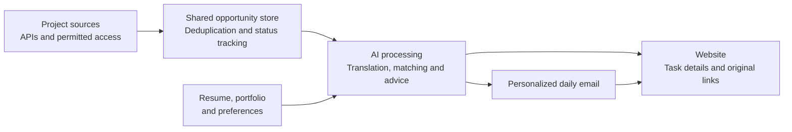

# Opportunity Lab

**Global freelance work, matched to your strengths.**

Opportunity Lab is an AI platform we are building for freelancers across industries. It brings together project opportunities from different platforms, understands a freelancer’s skills through their resume and portfolio, and delivers relevant work through **daily emails and a personalized website**.

Our goal: help freelancers spend less time searching, translating, and evaluating listings — and more time doing work they’re good at.

## Why we’re building this

Finding suitable work involves more than searching for a keyword. Freelancers need to compare requirements, check budgets and eligibility, understand unfamiliar languages, and decide whether their experience fits. They repeat that work across multiple websites before preparing an application.

We want to make that process easier by bringing opportunities to the person, with enough context to decide what to pursue.

## The experience we’re building

1. **Share your strengths.** Upload a resume and relevant work samples, then set preferences such as project type, budget, and language.
2. **Find relevant opportunities.** Bring together projects from different sources and match their requirements to your skills, experience, and preferences.
3. **Receive a daily email.** Get a personalized shortlist delivered to your inbox, with links to review each opportunity on our website.
4. **Understand the fit.** Read a translated summary, review the scope, budget, status, and eligibility, and see why the project was recommended. Keep access to the original posting.
5. **Prepare your application.** Get suggestions for relevant work samples, questions to ask, and points to address. You choose which projects to pursue and review your own application.

We aim to surface dozens of suitable projects a day when relevant supply allows. Relevance comes first; the daily count is a product goal, not a guaranteed quota.

## What makes this useful

| Focus | Value for the freelancer |
| --- | --- |
| **Proactive delivery** | Opportunities arrive by email, so discovery does not depend on repeatedly checking every platform. |
| **Matching based on your strengths** | Resume and portfolio information help identify relevant experience, skills, and style. |
| **Multiple sources, one shortlist** | Compare opportunities in a consistent format while retaining each original source link. |
| **Language support** | Understand project requirements in a familiar language. |
| **Reasons and application advice** | See why a project fits, what remains unclear, and how to prepare a relevant application. |

The intended advantage is this combined experience: personal matching, information from multiple platforms, language support, and application advice delivered proactively.

## Built for freelancers across industries

Our vision includes **art and illustration, software development, writing, design, marketing, and other freelance work**. Illustration is one demonstration scenario, not the limit of the product.

We want to make opportunities easier to discover across languages and locations. Each project’s location, account, and application requirements still matter and should remain visible.

## How it works



One shared pool of opportunities. A different shortlist for each person.

## Project stage and technology

Opportunity Lab is at the prototype stage. Our next integration milestone is to connect opportunity collection, profile understanding, and AI recommendations with real email delivery and subscription controls.

| Layer | Technology and role |
| --- | --- |
| Collection | Python, curl, and source adapters |
| Storage | SQLite, stable project IDs, transactions, and content versions |
| Scheduling | Python scheduling, request budgets, cooldowns, and run reports |
| Website prototype | HTML, CSS, and JavaScript |
| AI and profile processing | Resume parsing, multilingual models, and recommendation ranking |
| Email distribution | Email service API, delivery queue, and subscription preferences |

The runnable collector documented in this repository is `opportunity_intake`, which reads Freelancer projects. It includes persistent storage, deduplication, change detection, status rechecks, source-requested deletion, bounded scheduling, and observation reports. The commands below operate that collection component.

### Run the collector

Requirements: **macOS or Linux, Python 3.9+, and curl**. The collector needs no third-party Python packages at runtime.

From the repository root:

```bash
python3 -m opportunity_intake --help
python3 -m opportunity_intake run --query python --limit 5 --max-requests 2 --request-timeout 10 --max-seconds 30
python3 -m opportunity_intake list
python3 -m opportunity_intake runs
```

The example performs one bounded collection run and exits. It does not start a background schedule or send email. Data is stored locally in `data/freelancer.sqlite3`, which is excluded from Git. If the source requires credentials, provide `FLN_OAUTH_TOKEN` through the environment.

For saved fields, request limits, recovery, deletion, scheduling, and report interpretation, see the [collector guide](docs/collection-guide.md).

### Validate the collection component

```bash
python3 -m unittest discover -s tests -v
```

The automated tests use controlled source responses, clocks, and isolated storage. They do not require a live Freelancer account.

## Team

**Junzheng Jia · Annie Wu**
